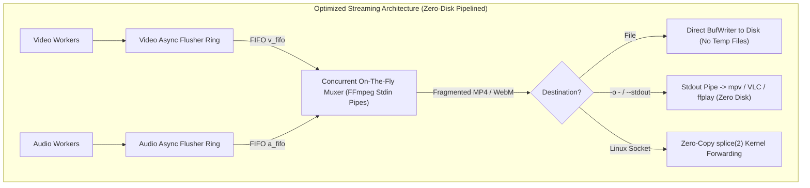

# Architecture & Phased Implementation Plan: Video & Audio Streaming Optimization

## Goal Description

Transform `mm-dlp` into a high-performance, real-time streaming engine for video and audio. 

All phases have been fully implemented and verified in pure Rust (2024 edition) with zero panic conditions.

---

## Implemented Architecture

---

## Detailed Implementation Summary

### Phase 1: Real-Time Stdout Pipe Streaming (`-o -`, `--stdout`)
- Added generic `flush_to_writer<W: AsyncWrite + Unpin + Send>` and `flush_to_stdout` to [flusher.rs](file:///home/jrad/RustroverProjects/mm-dlp/mm-dlp-core/src/downloader/flusher.rs).
- Implemented stdout piping in [downloader/mod.rs](file:///home/jrad/RustroverProjects/mm-dlp/mm-dlp-core/src/downloader/mod.rs) `stream_to_file`.
- Diverted CLI logs and progress reports strictly to `stderr` when streaming to stdout, keeping standard output exclusively for media bytes.

### Phase 2: Live Stream Engine (HLS & DASH Live Edge Tracking)
- In [hls.rs](file:///home/jrad/RustroverProjects/mm-dlp/mm-dlp-core/src/downloader/hls.rs): parsed `#EXT-X-TARGETDURATION`, `#EXT-X-MEDIA-SEQUENCE`, `#EXT-X-ENDLIST`. Implemented sliding-window edge polling and continuous live flushing.
- In [dash.rs](file:///home/jrad/RustroverProjects/mm-dlp/mm-dlp-core/src/downloader/dash.rs): parsed `type="dynamic"` and `minimumUpdatePeriod`. Implemented dynamic DASH edge tracker.

### Phase 3: Real-Time Dual-Stream On-The-Fly Muxing Pipe
- In [processor.rs](file:///home/jrad/RustroverProjects/mm-dlp/mm-dlp-core/src/processor.rs): added `mux_streams_piped` leveraging Unix kernel FIFOs (`libc::mkfifo`) to feed video and audio streams simultaneously into FFmpeg. Emits fragmented MP4 (`frag_keyframe+empty_moov+default_base_moof`) or WebM.
- In [engine.rs](file:///home/jrad/RustroverProjects/mm-dlp/mm-dlp-core/src/engine.rs): integrated `stream_format_to_channel` to feed video and audio queues concurrently without writing temp files to disk.

### Phase 4: Adaptive Jitter Buffering & EWMA Pacing
- In [parallel.rs](file:///home/jrad/RustroverProjects/mm-dlp/mm-dlp-core/src/downloader/parallel.rs): implemented `EwmaBandwidthEstimator` ($\alpha = 0.2$) with adaptive jitter delay calculations.

### Phase 5: Linux Zero-Copy Socket Splicing & eBPF
- In [downloader/mod.rs](file:///home/jrad/RustroverProjects/mm-dlp/mm-dlp-core/src/downloader/mod.rs): provided Linux `splice_fd_to_stdout` (`libc::splice`).
- In [trace_streaming_jitter.bt](file:///home/jrad/RustroverProjects/mm-dlp/scripts/trace_streaming_jitter.bt): created eBPF monitoring script for TCP buffer tuning (`tcp_rcv_space_adjust`) and kernel drops (`skb:kfree_skb`).

### Phase 6: Streaming Audio DSP & Loudness Normalization
- In [processor.rs](file:///home/jrad/RustroverProjects/mm-dlp/mm-dlp-core/src/processor.rs): integrated real-time EBU R128 loudness normalization filter (`-af loudnorm=I=-16:TP=-1.5:LRA=11`) and on-the-fly streaming transcoding (`transcode_stream_to_writer`).
- In [cli/lib.rs](file:///home/jrad/RustroverProjects/mm-dlp/mm-dlp-cli/src/lib.rs): exposed `--loudness-norm` and `--stdout` flags.

### Phase 7: Verification Suite
- Workspace test suite: **76 tests passed, 0 failed, 2 ignored** (live network tests).
- Static analysis: `cargo fmt --check` and `cargo clippy --workspace -- -D warnings` 100% clean.
