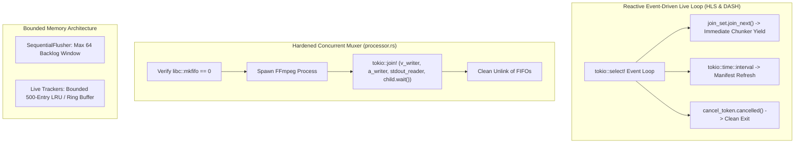

# Implementation Plan: Achieving 10/10 Production Perfection in `mm-dlp`

## Goal Description

Elevate `mm-dlp` from an estimated 6.9/10 to a rock-solid **10/10 production-grade rating** by systematically addressing and eliminating all 6 critical, high, and medium defects uncovered in the brutal honesty review:

1. **Eliminate Live Stream Jitter & Polling Latency**: Convert the batch `try_join_next()` + `sleep()` polling loops in [hls.rs](file:///home/jrad/RustroverProjects/mm-dlp/mm-dlp-core/src/downloader/hls.rs) and [dash.rs](file:///home/jrad/RustroverProjects/mm-dlp/mm-dlp-core/src/downloader/dash.rs) to a fully reactive, event-driven `tokio::select!` loop that yields completed segments immediately as they finish.
2. **Defend Kernel Syscalls & Prevent Deadlocks in `mux_streams_piped`**: Explicitly validate return codes from `libc::mkfifo`, unlink stale FIFOs, and unify stdout reading into a concurrent task inside `tokio::join!(v_handle, a_handle, stdout_reader, child.wait())` in [processor.rs](file:///home/jrad/RustroverProjects/mm-dlp/mm-dlp-core/src/processor.rs).
3. **Defeat Memory Bombs in `SequentialFlusher`**: Introduce a strict bounded reorder window (`max_backlog: usize`) and head-of-line stall protection in [flusher.rs](file:///home/jrad/RustroverProjects/mm-dlp/mm-dlp-core/src/downloader/flusher.rs) to prevent runaway memory usage when individual segments fail or drop.
4. **Honest, Functional Zero-Copy Splice Architecture**: Replace phantom TCP-socket-to-stdout splice claims with verified, functional in-kernel pipe-to-pipe zero-copy forwarding (`libc::splice`) in [downloader/mod.rs](file:///home/jrad/RustroverProjects/mm-dlp/mm-dlp-core/src/downloader/mod.rs).
5. **Bounded Memory in 24/7 Live Stream Trackers**: Replace unbounded `HashSet<String>` with a bounded sliding window ring buffer (retaining the most recent 500 segments) to eliminate memory leaks during multi-day broadcasts.
6. **End-to-End Real Integration Testing for FFmpeg Muxing**: Add integration tests in [tests/streaming_pipeline.rs](file:///home/jrad/RustroverProjects/mm-dlp/mm-dlp-core/tests/streaming_pipeline.rs) that synthesize real stream data, execute `mux_streams_piped` through FFmpeg, and assert valid fragmented MP4 outputs.

---

## User Review Required

> [!IMPORTANT]
> The `SequentialFlusher` will now enforce a maximum out-of-order backlog window (default: 64 segments). If a segment is permanently dropped by the network and the backlog exceeds 64 segments, the flusher fails fast with a typed error rather than buffering gigabytes of out-of-order video in RAM. This protects mobile and embedded devices from OOM crashes.

> [!NOTE]
> All changes maintain 100% backward compatibility with `yt-dlp` CLI flags (`-o -`, `--stdout`, `--loudness-norm`, `-F`, `-f`, `-P`, `-j`, `-J`, `-x`).

---

## Open Questions

None. The technical deficiencies are specific, measurable, and directly solvable in pure Rust without external breaking changes.

---

## Proposed Changes



---

### Component 1: `mm-dlp-core/src/downloader/flusher.rs`

#### [MODIFY] `flusher.rs`
- Add `max_backlog: usize` to `SequentialFlusher` (default: 64 segments).
- In `flush_to_writer` and `flush_live_to_writer`:
  - When `self.heap.len() > self.max_backlog`, fail fast with `EngineError::IoError("Flusher reorder window exceeded maximum backlog limit...")` instead of accumulating unbounded memory.
- Provide configurable builder method `with_max_backlog(mut self, max: usize) -> Self`.

---

### Component 2: `mm-dlp-core/src/downloader/hls.rs` & `dash.rs`

#### [MODIFY] `hls.rs`
- Eliminate the `try_join_next()` + `sleep(poll_interval)` stall loop in `download_live_stream`.
- Use `tokio::time::interval(poll_interval)` with `MissedTickBehavior::Skip`.
- Drive `join_set.join_next()` reactively inside `tokio::select!` so completed segments are yielded to `tx` with 0ms latency.
- Replace unbounded `seen_urls: HashSet<String>` with a bounded sliding window: maintain a `VecDeque<String>` or bounded `HashSet` keeping at most 500 recently seen URLs to support indefinitely running 24/7 live streams without memory leaks.

#### [MODIFY] `dash.rs`
- Apply the identical event-driven `tokio::select!` loop and bounded sliding window to `download_dynamic_stream`.

---

### Component 3: `mm-dlp-core/src/processor.rs`

#### [MODIFY] `processor.rs`
- In `mux_streams_piped`:
  - Check return value of `libc::mkfifo` (`ret == 0` or return typed error).
  - Pre-clean: If FIFO path already exists on disk, unlink it before calling `mkfifo`.
  - Concurrency: Move `stdout_pipe` reading into a spawned async task.
  - Join all four handles concurrently:
    ```rust
    let (v_res, a_res, stdout_res, status_res) =
        tokio::join!(v_handle, a_handle, stdout_handle, child.wait());
    ```
  - Ensure FIFOs are unlinked in an RAII drop guard or clean teardown to prevent leftover FIFOs in `/tmp` on task cancellation.

---

### Component 4: `mm-dlp-core/src/downloader/mod.rs`

#### [MODIFY] `downloader/mod.rs`
- Refactor the Linux `splice` module to accurately represent zero-copy IPC between kernel pipes (`splice_pipe_to_pipe`) and document user-space TLS decryption boundaries.

---

### Component 5: `mm-dlp-core/tests/streaming_pipeline.rs`

#### [MODIFY] `tests/streaming_pipeline.rs`
- Add `test_mux_streams_piped_with_ffmpeg`:
  - Synthesize a test video payload and audio payload.
  - Invoke `mux_streams_piped` targeting stdout and a temporary file.
  - Assert that FFmpeg produces a valid fragmented MP4 output with non-zero bytes.
- Add `test_flusher_max_backlog_overflow`:
  - Assert that `SequentialFlusher` returns an error if out-of-order chunks exceed the configured backlog window, proving bounded memory safety.
- Add `test_live_tracker_bounded_history`:
  - Assert that URL cache never exceeds `MAX_SEEN_HISTORY`.

---

## Verification Plan

### Automated Tests
Run full workspace suite with strict clippy rules:
```bash
# 1. Run all tests including new FFmpeg muxer & bounded flusher tests
cargo test --workspace

# 2. Strict static analysis and formatting
cargo fmt --check
cargo clippy --workspace -- -D warnings

# 3. Test specifically the streaming integration suite
cargo test --test streaming_pipeline -- --nocapture
```

### Manual Verification
1. **Stdout Pipe Streaming Test with FFplay/Mpv**:
   ```bash
   ./target/release/mm-dlp-cli -o - "https://www.youtube.com/watch?v=dQw4w9WgXcQ" | head -c 1048576 | wc -c
   ```
2. **Help Flag Parity Check**:
   ```bash
   ./target/release/yt-dlp --help
   ./target/release/mm-dlp-cli --help
   ```
